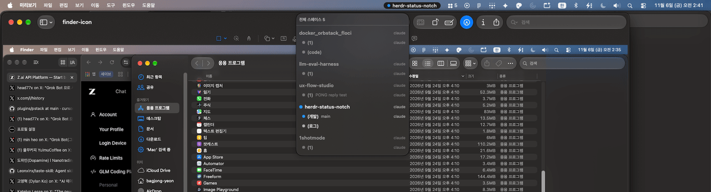

# Herdr Status Notch

> A macOS menu bar widget that watches herdr coding-agent workspaces for
> bottlenecks. Space chips in the menu bar, a notch panel with tab-level
> detail, click-to-focus on any space or tab.
> Inspired by Codex Micro 2.

herdr 세션의 스페이스별 병목 상태를 맥 메뉴바와 노치 아래 패널로 보여 주는
macOS 앱이다. 목적은 "에이전트가 병목에 빠지지 않기"다. 0.7초 간격으로
`herdr api snapshot`을 폴링해 워크스페이스 칩을 메뉴바에 띄우고, 행을 클릭하면
`herdr workspace focus <id>` / `herdr tab focus <tab_id>`로 포커스를 옮긴다.
색 매핑은 Codex Micro 2에서 영감을 받았다.



위 GIF는 실사용 화면이다. 메뉴바의 스페이스 칩(상태 점 1개 + 프로젝트명)과
노치 아래 패널(스페이스 섹션 + 탭 행)이 보이고, 작업명이 실시간으로
나타났다 사라진다(summary 메타데이터 토큰 반영).

## 메뉴바 구성

- **앱 아이콘**(MenuBarExtra). 그리드 아이콘 + 대기(idle) 인원수 뱃지.
  0명이면 숫자가 없고, herdr가 오프라인이면 아이콘이 빨간색이다.
- **스페이스 칩**(NSStatusItem). 신호(blocked·working·done·unknown)가 있는
  워크스페이스만 캡슐 칩으로 뜬다. 칩은 스페이스 최악 상태 점 1개와
  워크스페이스 라벨로 구성되고 idle뿐인 잠든 스페이스는 숨겨진다. 정렬은
  심각도(blocked → working → done → unknown)순, 동률은 워크스페이스 번호순,
  상한 8개(초과분은 드롭다운 스페이스 지도에서 확인). 칩을 클릭하면 메뉴
  없이 곧바로 그 스페이스로 포커스가 옮겨진다(`herdr workspace focus`).

## 상태 색

macOS 시맨틱 색을 그대로 쓴다(브랜드 색 아님). 칩에는 idle 점이 없다.

| 상태 | 색 |
| --- | --- |
| working | 파랑 |
| done | 초록 |
| blocked | 호박(주황) |
| unknown(모르는 값 폴백) | 회색 |
| idle | 회색(노치 패널 탭 점 전용) |
| herdr 오프라인 | 빨강 |

## 앱 아이콘 드롭다운

정보 단위는 스페이스 하나다(에이전트는 칩·패널의 드릴다운 디테일).

1. herdr 오프라인이면 첫 행에 빨간 경고.
2. 스페이스 지도. 전체 스페이스를 띄우고 각 행은 상태 점 다발 + 라벨.
   잠든 스페이스(전원 idle)는 흐리게 + "대기" 태그. 클릭하면 그 스페이스로
   포커스(`herdr workspace focus`).
3. 노치 패널 토글, 로그인 시 시작 토글(스위치)과 종료.

## 작업명 표시

작업명은 두 단계로 얻는다. 에이전트 시작 시 심은 공식 메타데이터
(`herdr pane report-metadata <pane> --source <source> --token summary="..."`)
가 있으면 그 값을 쓰고, 없으면 터미널 제목에서 상태 글리프(✳ ◑ ◐)와
도구 이름("Claude Code" 등)을 걸러 얻는다. 노치 패널 탭 행(탭명 옆에)과 칩
클릭 메뉴에서 보여 준다.

## 칩 사라짐 기준

스페이스에 신호(blocked·working·done·unknown)가 없으면 칩이 즉시 숨겨진다.
done은 herdr 설계상 사용자가 해당 에이전트를 확인하면 idle로 전환되므로,
확인이 곧 칩 소멸의 방아쇠다. 별도 타이머가 없다.

## 노치 패널

스페이스별 섹션으로 구성한다(헤더 "전체 스페이스 N" + 각 스페이스 섹션).
스페이스 섹션은 헤더 줄(대표 상태 점 · 스페이스명 · 에이전트 종류 요약)과
그 아래 탭 행들로 이뤄진다. 탭은 herdr 위계(스페이스 > 탭 > 패널)의 중간
단위로 패널(pane) 여럿을 품을 수 있다. 탭 행은 상태 점 · 탭명 · 작업명 ·
모델 종류를 한 줄로 보여 준다(작업명·모델은 탭 소속 에이전트에서 모은다).
탭 행을 클릭하면 `herdr tab focus <tab_id>`로, 섹션 헤더를 클릭하면
`herdr workspace focus`로 포커스가 옮겨진다. 탭 점은 탭 단위
agent_status를 쓰며 idle 탭은 회색 점으로 구분한다. 신호가 없는 잠든
스페이스는 섹션 전체가 옅게 표시된다. 토글(`UserDefaults`의
`notchPanelEnabled`, 기본 켜짐)로 표시를 끄면 패널을 만들지도 않는다.
패널의 빈 영역을 드래그해 옮길 수 있고 위치는 `UserDefaults`의
`notchPanelOrigin`에 저장돼 다음 실행에 복원된다.

## 요구 사항

- macOS 14.0 이상
- [XcodeGen](https://github.com/yonaskolb/XcodeGen) (`brew install xcodegen`)
- Xcode 명령줄 도구(`xcodebuild`)
- herdr CLI가 설치되어 있을 것. 앱은 PATH를 순회한 뒤
  `~/.local/bin/herdr`를 폴백으로 찾는다.

## 실행법

```bash
cd herdr-status-notch
xcodegen generate
xcodebuild -project HerdrStatusNotch.xcodeproj -scheme HerdrStatusNotch -configuration Debug build
```

빌드 산출물은 `~/Library/Developer/Xcode/DerivedData/HerdrStatusNotch-*/Build/Products/Debug/HerdrStatusNotch.app`에 생긴다. 응용 프로그램 폴더로 복사해 두고 더블클릭으로 실행한다.

```bash
cp -R ~/Library/Developer/Xcode/DerivedData/HerdrStatusNotch-*/Build/Products/Debug/HerdrStatusNotch.app /Applications/
```

Release에서 .app zip을 내려받은 경우도 같다. 풀어서 응용 프로그램 폴더에 넣고 실행. 이 앱은 ad-hoc 서명이라 인터넷에서 받은 첫 실행엔 게이트키퍼가 물어본다. 우클릭 → 열기로 한 번 허용하면 이후는 더블클릭으로 뜬다.

또는 `xcodegen generate` 후 `HerdrStatusNotch.xcodeproj`를 Xcode에서 열어 실행한다.
`.xcodeproj`는 XcodeGen 산출물이라 저장소에 넣지 않는다(`.gitignore` 참조).

실행하면 메뉴바에 앱 아이콘과 스페이스 칩이 생기고, 노치 패널 토글이 켜져
있으면 화면 상단 중앙에 패널이 뜬다. Dock 아이콘은 숨겨지고(런타임에
accessory 전환) 런치패드에는 아이콘이 노출된다.

## 권한 안내

- `herdr agent focus`가 터미널 창 전환에 AppleScript/System Events를 쓰면
  macOS가 접근성 권한을 요구할 수 있다. 시스템 설정 → 개인 정보 보호 및
  보안 → 접근성에서 이 앱을 허용한다.
- 폴링은 읽기 전용 `herdr api snapshot`만 실행하므로 별도 권한이 필요 없다.
- 로그인 시 시작은 드롭다운에서 켠다(SMAppService, 응용 프로그램 폴더에
  설치된 상태여야 등록이 유지된다).

## 현재 한계

- 상태 갱신은 폴링(0.7초) 전용이다. 이벤트 스트림이나 웹소켓 구독이 없다.
- 노치 실측 좌표 기반 배치가 없다(저장 위치가 없으면 상단 중앙 고정).
- focus 명령의 성공/실패 피드백이 없다.
- 작업명은 summary 토큰·터미널 제목·git 브랜치 어느 것도 없으면 비게 된다.

## 성능 (실측)

- 폴링 한 주기(0.7초)의 비용. `herdr api snapshot` 1회 약 5ms, git 브랜치
  조회는 서로 다른 cwd당 약 19ms(신호 탭 소속 에이전트만, 같은 cwd는 한 번).
  모두 백그라운드 큐에서 순차 실행되고 응답이 늦으면 다음 틱을 건너뛴다.
- 메뉴바 칩은 내용이 바뀐 것만 다시 그린다. NSStatusItem 생성·삭제는
  스페이스 구성이 바뀔 때만 일어난다.

## 보안

- 네트워크 송수신이 없다. 디스크 쓰기는 UserDefaults 두 키(패널 토글·좌표)뿐이다.
- 모든 외부 프로세스 실행은 인자 배열 전달(셸 없음). herdr는 PATH 순회 후
  고정 폴백 경로, git은 /usr/bin/git 고정. 명령어 주입 경로가 없다.
- 외부 입력(herdr JSON)은 디코드 경계 한 곳에서만 파싱하고 전 필드를
  옵셔널로 읽는다(키 가변성 대응).

## 라이선스

MIT

## 구조

- `Sources/App` — 앱 진입(MenuBarExtra)과 NSPanel·NSStatusItem 생명주기 담당 AppDelegate
- `Sources/Herdr` — herdr CLI 클라이언트, 데이터 모델(AgentSlot·WorkspaceInfo·TabInfo·SpaceChip·AgentStatus), 폴링 저장소
- `Sources/ChipBar` — 메뉴바 스페이스 칩(NSStatusItem diff 관리)과 스페이스 메뉴
- `Sources/NotchPanel` — 드래그 가능한 NSPanel과 배치 컨트롤러
- `Sources/Views` — 노치 패널 뷰, 앱 아이콘 드롭다운 뷰
